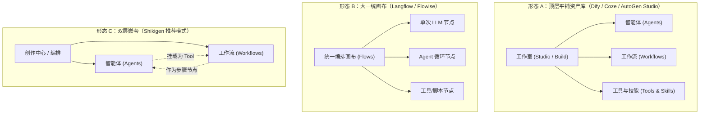

# 智能体（Agent）与工作流编排（Workflow）：主流架构与前端设计调研

> 调研日期：2026-10-25\
> 适用范围：Shikigen 前端工作台新增「智能体」与「工作流编排」模块架构设计与交互规划\
> 调查样本：DeepSeek Harness (`deepseek-ai/deepseek-harness`)、OpenClaw、Hermes (`NousResearch/hermes-agent`)、deer-flow / LangGraph、Dify (`langgenius/dify`)、Coze (扣子)、AutoGen Studio (`microsoft/autogen`)、Langflow (`langflow-ai/langflow`)

---

## 1. 调研背景与核心问题

在自主 Agent 系统向生产级演进的过程中，开发者往往面临两套看似重合却机制迥异的概念：
1. **智能体（Agent）**：以 LLM 为核心决策引擎，自主循环规划、动态选择工具完成目标的自主实体。
2. **工作流编排（Workflow Orchestration）**：以有向无环图（DAG）或状态机为骨架，确定性地执行步骤、数据转换与条件分支的流水线。

本调研针对以下三个核心问题展开：
- **组织形态**：前端是将两个模块独立呈现，还是收纳在同一个大模块（如工作室 / 资产库）下？
- **功能边界**：两个模块各自包含哪些核心功能与界面元素？
- **异同对比**：两者在架构哲学、执行机制、交互范式上的共同点与本质差异是什么？

---

## 2. 调研对象与架构呈现

### 2.1 主流平台调研样本

| 平台 / 框架 | 模块组织形式 | 相互嵌套关系 | 来源与技术特点 |
| :--- | :--- | :--- | :--- |
| **Dify** | **并列资产**（工作室下一级：Chatbot / Agent / Workflow / Chatflow） | 互为积木：Workflow 内可插 Agent 节点；Workflow 可发布为工具被 Agent 调用 | [Dify 仓库](https://github.com/langgenius/dify)：成熟的企业级双轨体系，UI 明确区分表单配置与 React Flow 画布 |
| **Coze (扣子)** | **并列资产**（Bot 与 Workflow 分别独立管理） | Bot 详情页中，Workflow 可作为「技能（Workflow as Tool）」挂载给 Bot | 字节跳动 Coze：强调资产复用，Bot 偏业务角色，Workflow 偏后端逻辑接口 |
| **AutoGen Studio** | **并列标签页**（Build 顶栏平铺：`Agents` / `Workflows` / `Models` / `Tools`） | Workflows 定义多 Agent 拓扑（TwoAgent、GroupChat）；Agents 是节点组件 | [AutoGen Studio](https://github.com/microsoft/autogen)：微软多智能体实验台，Workflow 负责组织多 Agent 之间的发言规则与协作流 |
| **Langflow / Flowise** | **大一统画布（Canvas-First）** | Flow 即一切；Agent 作为 Flow 画布中的一个 ReAct 节点或循环子图 | [Langflow 仓库](https://github.com/langflow-ai/langflow)：技术型流式编排，抹平单 Agent 与工作流的菜单边界 |
| **deer-flow (LangGraph)** | **代码级 Graph 抽象** | Agent 是带自循环条件边的 Subgraph；Workflow 是确定性 StateGraph | 基于 LangGraph 规范：概念上统一为图（Graph），但在前端或监控中区分是自循环还是确定性推进 |
| **DeepSeek Harness** | **执行循环与评估管道解耦** | Harness 负责 Agent 的环境观测与沙箱控制；评测与多阶段管道通过确定性流程驱动 | `deepseek-ai/deepseek-harness`：强调确定性 Pipeline（Workflow）用于任务准备与回归验证，自主 Agent Loop 用于长任务求解 |
| **OpenClaw** | **调度器 + 专家智能体模式** | Workflow 定义任务分解树（DAG）；Agent 作为被派发的执行单元（Specialist） | 开源任务求解平台：工作流负责整体状态规划，叶子节点由不同具备专有工具的 Agent 闭环求解 |
| **Hermes (`hermes-agent`)** | **函数调用循环 + 宿主状态机** | Agent 具备自主 Function Calling 循环；外部系统用 Workflow 管理长生命周期 | `NousResearch/hermes-agent`：单 Agent 依赖上下文动态调 Tool，上层工作流处理外部鉴权、分支与业务落库 |

---

## 3. 两个模块是独立还是放在一个大模块里面？

业界存在三种主流的界面组织形态：



### 形态 A：在统一的工作室/创作中心下，作为并列的两个子模块（主流首选）
* **做法**：一级菜单为「工作台 / 编排中心」，二级分为「智能体」与「工作流」。
* **设计理由**：
  1. **UI 容器范式冲突**：
     * **Agent 详情页**是**表单 + 对话调试器**（左侧人设、模型参数、工具勾选；右侧类似 ChatGPT 的实时试跑窗口）。
     * **Workflow 详情页**是**全屏无限节点画布（Node-based Canvas）**，需要广阔的缩放、平移空间与节点连线体验。
     * 若将两者硬合在同一个详情视图内，UI 控件密度与交互操作会严重打架。
  2. **心理模型不同**：
     * 用户进入「智能体」是想**设定一个角色或助手**；
     * 用户进入「工作流」是想**定义一条确定性的业务流水线**。

### 形态 B：全画布模式（技术型开发台）
* **做法**：只有一个「编排画布（Flows）」。
* **优缺点**：适合技术极客（像搭电路一样把 Agent 和 Tools 连在一起），但对普通用户而言，只想快速配一个客服 Agent 却要拖拽 5 个节点连线，上手门槛过高。

### 针对 Shikigen 的结论与建议
* **建议采用“形态 A（并列管理）+ 形态 C（互为积木）”**：
  在导航栏将「智能体」与「工作流」作为平级的两个模块，但在底层建立引用协议：
  1. **Workflow as a Tool**：任何写好的工作流，均可一键发布为 Agent 的工具，由 Agent 自主在对话中根据意图调用。
  2. **Agent as a Node**：在工作流画布中，提供「智能体节点」，可以将某个复杂、非确定性的子步骤交给指定的 Agent 执行。

---

## 4. 两个模块各自的功能体系

### 4.1 智能体（Agent）模块功能

Agent 的核心目标是**赋予 LLM 角色身份、自主规划决策能力与工具调用权限**。

```
┌───────────────────────────────────────────────────────────────┐
│                     Agent 详情配置工作台                      │
├───────────────────────────────────┬───────────────────────────┤
│ 左侧：人设与能力编排 (Form/Drawer)│ 右侧：实时调试 (Playground)│
│                                   │                           │
│ 1. 基础配置 (Identity)            │ 模拟会话窗口 (Chat Area)  │
│    - 头像、名称、标识 ID、描述    │ - 多轮交互测试            │
│ 2. 人设指令 (Prompt & Persona)    │ - 流式思考链 (Reasoning)  │
│    - System Prompt、安全/角色边界 │ - 工具调用轨迹 (Tool Trace)│
│ 3. 模型与推理 (Model Settings)    │ - 人工审批干预 (HITL Card)│
│    - 模型选择、Temp、Top-P、MaxLen│ - Token 实时用量统计      │
│ 4. 挂载能力 (Capabilities)        │                           │
│    - 绑定工具 (Tools / MCP)       │                           │
│    - 挂载知识库 (Knowledge / RAG) │                           │
│    - 关联工作流 (Workflow as Tool)│                           │
│ 5. 记忆与运行策略 (Memory/Policy) │                           │
│    - 短期上下文窗口、长期向量记忆 │                           │
│    - 最大循环轮数 (Max Steps)     │                           │
└───────────────────────────────────┴───────────────────────────┘
```

#### Agent 核心功能清单：
1. **身份与行为设定（Persona & System Prompt）**：人设、背景规则、格式约束。
2. **模型引擎与采样参数（Model Configuration）**：选用特定底座模型及温度、上下文滑动窗口策略。
3. **能力挂载（Capabilities Integration）**：
   - 勾选允许调用的 **Tools**（HTTP / Python / 本地命令）
   - 勾选允许接入的 **MCP 服务**
   - 关联 **Skills**（SOP 最佳实践指南）
   - 关联 **Workflows**（作为专用工具调用）
   - 挂载 **知识库**（检索增强 RAG）
4. **记忆与状态策略（Memory & Persistence）**：会话历史压缩策略、上下文上限处理、状态恢复规则。
5. **执行策略与护栏（Execution Guardrails）**：单次任务最大循环次数（防死循环）、超时时间、敏感工具人机协同审批（HITL）开关。
6. **即时调试沙盒（Playground）**：支持即时发送消息、观察工具调用过程和结算用量。

---

### 4.2 工作流编排（Workflow）模块功能

工作流的核心目标是**构建确定性的、低容错、有步骤流转的数据与任务管道**。

```
┌───────────────────────────────────────────────────────────────┐
│                  Workflow 可视化 DAG 编排画布                 │
├───────────────────────────────────────────────────────────────┤
│ 工具栏：节点库 | 整理连线 | 放大/缩小 | 运行测试 | 导出/发布 │
├───────────────────────────────────────────────────────────────┤
│                                                               │
│  [开始节点] ──> [知识库检索] ──> [条件判断] ─Yes─> [Agent节点] │
│   (Input)         (RAG)        (If/Else)            │         │
│                                    │                │         │
│                                    No               ▼         │
│                                    │          [代码转换节点]  │
│                                    ▼          (Python/JS)     │
│                              [直接输出]             │         │
│                                                     ▼         │
│                                                 [结束节点]    │
│                                                  (Output)     │
├───────────────────────────────────────────────────────────────┤
│ 底部/抽屉：单节点调试日志 | 运行结果查看 | 变量流转追踪      │
└───────────────────────────────────────────────────────────────┘
```

#### 工作流核心功能清单：
1. **可视化 DAG 画布（Node-based Graph Canvas）**：
   - 节点拖拽、连线、吸附、对齐与折叠。
2. **丰富的基础节点库（Node Registry）**：
   - **触发/输入节点（Start / Trigger）**：定义流程入参结构（Schema）、触发方式（Manual / Webhook / Event）。
   - **LLM 节点**：单次、非循环的 Prompt 补全调用。
   - **代码与转换节点（Code / Transform）**：Python / JavaScript 代码块，处理数据清洗、正则、JSON 解析。
   - **逻辑控制节点（Control Flow）**：条件分支（If-Else）、循环遍历（Iterator/Loop）、并发分支（Parallel）与汇聚（Merge）。
   - **工具/接口节点（HTTP / Tool / MCP）**：执行具体的原子 API 调用。
   - **智能体节点（Agent Node）**：将控制权交由一个拥有自主工具循环的 Agent，等其解决后取回结果。
   - **结束/响应节点（End / Response）**：组装最终输出并返回结构化数据。
3. **变量绑定系统（Variable Binding & Expression）**：
   - 上下游节点间严格的变量引用表达式（如 `{{start.input_text}}`、`{{llm_1.text}}`）。
4. **测试与追踪（Tracing & Observability）**：
   - 单节点单独运行测试（快速验证 Python 脚本或单个 Prompt）。
   - 全流程单步调试（逐个节点高亮执行、查看输入/输出快照）。
5. **发布与导出（Publishing）**：
   - 发布为独立 REST API / Webhook。
   - **发布为 Agent 工具**（自动生成工具描述与入参 Schema）。

---

## 5. 两个模块的差异点与共同点

### 5.1 核心异同对照表

| 维度 | 智能体（Agent） | 工作流（Workflow） |
| :--- | :--- | :--- |
| **本质哲学** | **目标导向（Goal-oriented）**：重在“给目标，自定路径” | **过程导向（Process-oriented）**：重在“给路径，严格执行” |
| **控制主体** | **模型掌舵（LLM-driven）**：LLM 拥有控制循环，决定调什么、调几次 | **代码与连线掌舵（Code/Graph-driven）**：拓扑结构决定走向，LLM 仅充当单一计算节点 |
| **确定性与容错** | 灵活性极高，但确定性偏低；适合开放对话、复杂探索、长程排错 | 确定性极高，容错要求严苛；适合标准化业务流、格式转换、严格合规场景 |
| **输入与输出** | 多轮自然语言消息流（`messages: Message[]`），伴随上下文演进 | 确定性的强类型结构（`Input: JSON` $\to$ `Output: JSON`） |
| **前端交互范式** | **双栏结构**：左侧属性表单 + 右侧即时聊天对话框 | **无限画布（Canvas）**：类似 React Flow，节点连线、拖拽排版 |
| **人机交互（HITL）** | 运行时在会话中弹出操作审批卡（批准/拒绝单个工具动作） | 在流程图中断点等待用户确认，或通过表单填入中间变量 |
| **调试难度** | 较难复现：由于 LLM 随机性，同一问题两次思考路径可能不同 | 容易复现：单节点可独立 Mock 入参、单步断点重试 |

### 5.2 共同点（底层技术契约）
1. **共享基础设施**：两者在底层完全共享模型供应商连接、Token 用量计算、MCP/Tools 接入层、知识库检索通道。
2. **统一的生命周期与事件流**：无论是 Agent Loop 还是 Workflow 运行，在底层均抽象为一次运行（`Run`），均产生流式事件（`token`、`node_start`、`tool_call`、`completed`、`failed`），支持统一的取消（Abort）与 Checkpoint 恢复。
3. **互为构建基石**：
   * **Workflow as a Tool** 弥补了 Agent 容易“天马行空”的缺点，把复杂而严格的步骤固化在工作流中供 Agent 随时调遣；
   * **Agent as a Node** 弥补了 Workflow 过于死板的缺点，在需要开放创造或多轮探索的节点插上一个 Agent。

---

## 6. 对 Shikigen 桌面工作台的前端架构实施建议

结合 Shikigen 当前基于 React + TypeScript + Tauri 的桌面工作台架构现状，建议采取以下阶段性落地路径：

### 阶段一：导航与空间划分（保持并列）
在主导航中，将编排与应用资产集中归入「编排中心」或平级展开：
```tsx
// 导航层级设计示意
- 会话与对话 (Chat)
- 智能体 (Agents)          <-- 新增：专注于 Prompt、工具绑定与角色设定
- 工作流编排 (Workflows)   <-- 新增：基于 DAG 画布的流水线设计
- 知识库与向量空间 (Knowledge)
- 扩展 (Extensions)
  - 工具 (Tools)
  - MCP 服务 (MCP Connections)
  - 技能 (Skills)
```

### 阶段二：智能体模块优先落地
* 优先实现智能体（Agent）配置页，采用经典的“左侧配置抽屉 / 右侧聊天调试”布局：
  * 左侧：选择模型、填写 System Prompt、勾选已有工具库（Tools/MCP）及技能（Skills）。
  * 右侧：复用已有会话组件，直接挂载新建的 Agent 实例进行多轮对话与工具调用观察。

### 阶段三：工作流画布集成与互通协议
* 引入轻量级节点编排库（如 `@xyflow/react` / React Flow）。
* 落地两个关键互通点：
  1. 工作流详情页右上角提供 **「发布为工具」** 按钮，自动将工作流注册进现有 `ToolLibrary`，入参对应工作流开始节点的 Schema。
  2. 工作流节点选择器中包含 **「调用智能体」** 节点，可下拉选择阶段二创建的任一 Agent。

---

## 7. 来源与参考资料
- **DeepSeek Harness** (`deepseek-ai/deepseek-harness`): 长期上下文规划与执行循环隔离设计。
- **NousResearch Hermes Agent** (`NousResearch/hermes-agent`): Function-calling 驱动的自主状态机与多轮工具调用范式。
- **OpenClaw**: 基于 DAG 任务树分解与 Specialist Agent 协作调度。
- **deer-flow / LangGraph**: StateGraph 与 Cyclic Subgraph 的图抽象理论。
- **Dify 架构文档**: [Dify Concepts - Agent vs Workflow](https://github.com/langgenius/dify)。
- **Microsoft AutoGen**: [AutoGen Studio Architecture](https://github.com/microsoft/autogen)。
- **Langflow 文档**: [Langflow Visual Components & Agent Nodes](https://github.com/langflow-ai/langflow)。
